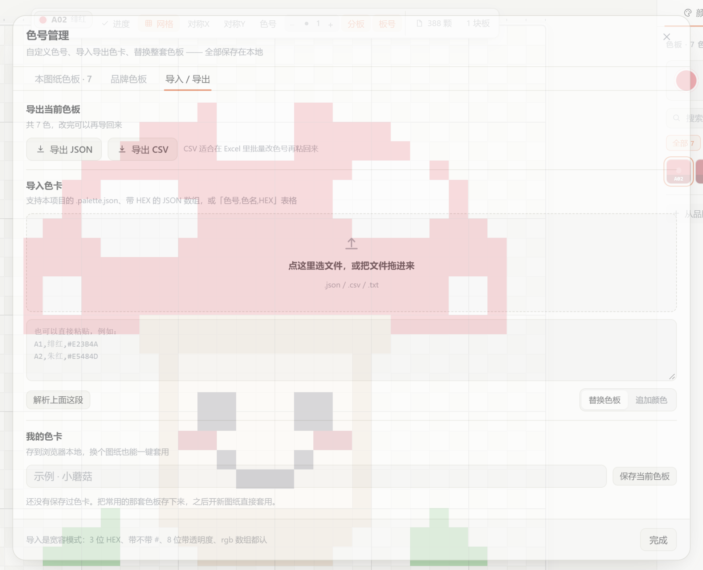
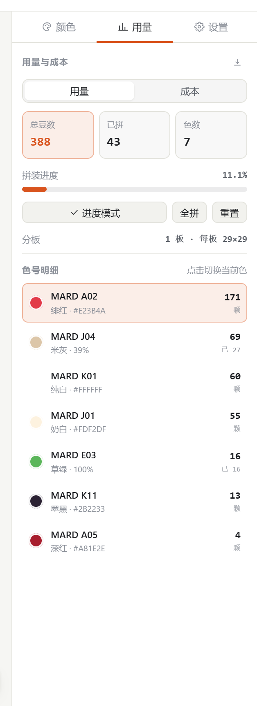
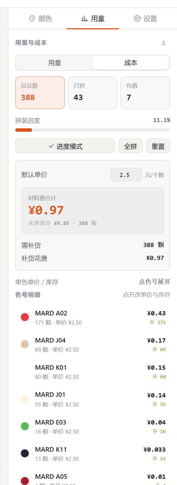
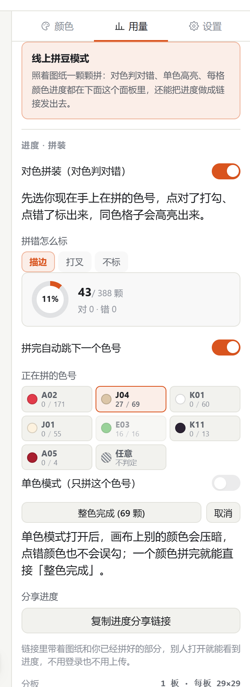
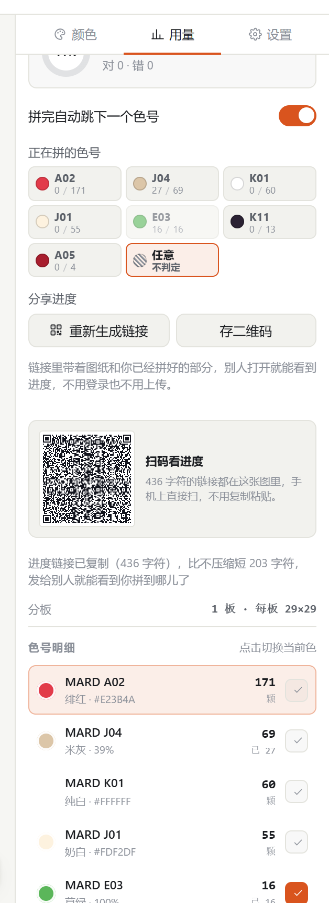
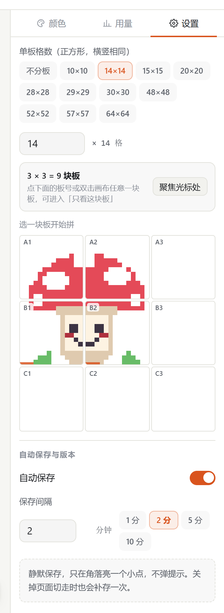
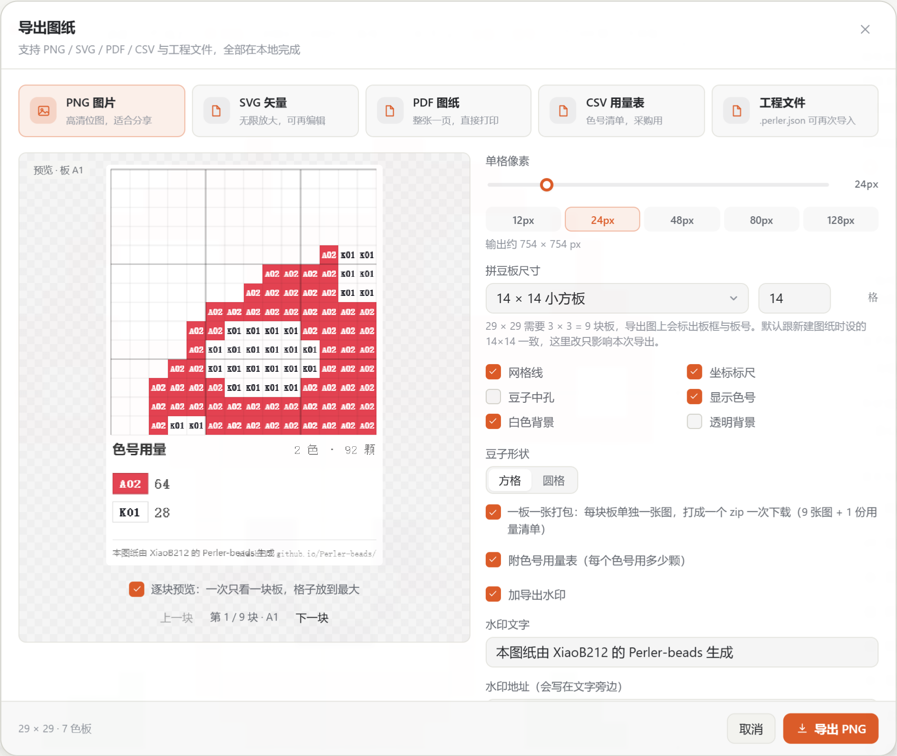
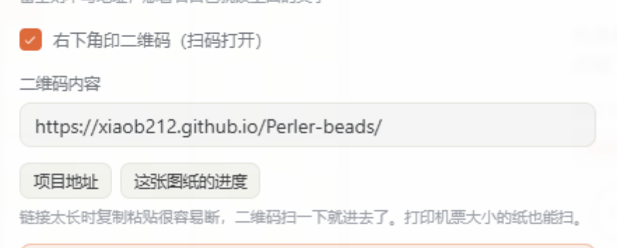
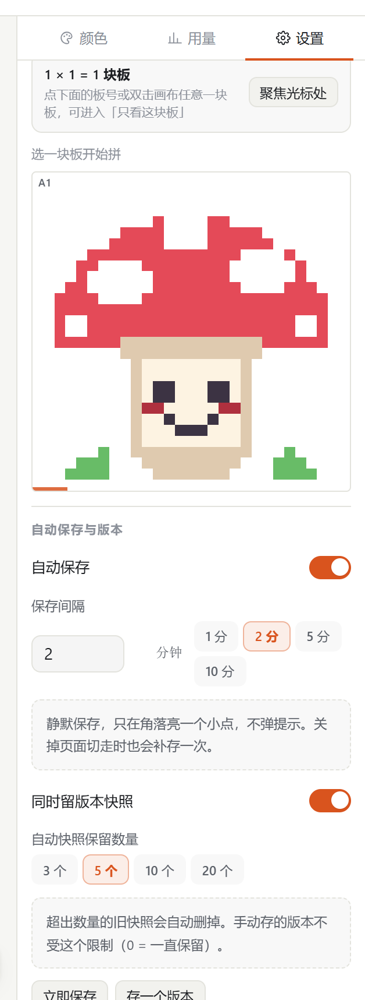

# 拼豆工作室 · Perler Studio

纯前端的拼豆（Perler Beads）图纸工具：画图纸、把图片转成图纸、算用量、算成本、勾进度、导出打印。

打开就能用，**不用登录、不用联网，所有图纸只存在你自己的浏览器里**。

在线地址：<https://xiaob212.github.io/Perler-beads/>

当前版本 **v1.1.0**（顶栏和设置页里都能看到版本号，用来确认线上是不是最新一版）。


---

## 目录

- [五步上手](#五步上手)
- [功能](#功能)
- [快捷键](#快捷键)
- [本地运行](#本地运行)
- [部署到 GitHub Pages](#部署到-github-pages)
- [技术栈](#技术栈)
- [更新日志](#更新日志)
- [色号数据来源](#色号数据来源)
- [许可](#许可)

---

## 五步上手

### 1. 建一张画布

点右上角「新建」。「单块拼豆板格数」先定实体板多大（默认 64，常见 29 / 48 / 64 都能点），
再点「用几块板」里的 `2 × 2 块` / `3 × 3 块`，画布尺寸就是这两个数相乘（29 格 × 2 × 2 = 58 × 58）。
也可以直接在下面填任意宽高；关掉「保持正方形」就能做长方形，单边最大 1024 格。

这里选的板规格会跟着图纸走：画布上的分板线、板号、导出面板的「拼豆板尺寸」默认都用它。


### 2. 选颜色，开始画

右边色板里每个色块上都印着色号，不用点开才知道是哪个色。点一下就选中，然后左键画、右键擦。
网格、坐标标尺、豆孔、分板线都在画布上方的工具条里开关。


### 3. 或者把一张图片直接变图纸

点「图片转图纸」，把图片拖进去（也可以直接把图片拖到窗口任意位置）。
**先定单板格数，再定横 × 纵拼几块板**，成品就按这套实体板尺寸切好；下面就是实时预览。
抖动、采样方式、亮度 / 对比度 / 饱和度都能调，选好色板后点「生成图纸」。

左栏的「原图」可以拖动挪位置、滚轮缩放，只取画面里想要的那一块；右栏的「图纸预览」上还能直接抠图：
**框选**（像 PS 选区一样拖一个方框，可以整块抠掉 / 补回 / 只留框内）、
**魔棒**（点一下选一片同色连通区，鼠标停上去就先高亮出要吃的范围，还能切「吃全图同色」）、
**笔刷**（1~8 格，一点点修边）、**一键抠掉背景**（四边连通的底色一次清掉）。
抠掉的格子不参与配色、不计颗数、也不占板子，「按内容裁掉多余板子」会把四周空板收掉。
导入过的图片还能点顶栏「重调图片」，带着上次的裁切和抠图回到这个对话框接着改。


### 4. 勾进度

打开「进度」模式，点已经拼好的豆子就会打勾，没拼的自动变暗，一眼看出拼到哪。
「用量」页同步显示总颗数、已拼、剩余，以及每个色号还差多少颗。

要是想照着图纸一颗颗拼、还得判对错，就打开「线上拼豆模式」（左侧工具条、顶栏、手机工具条上的「线上」按钮）——
它是一整套独立的拼装状态：对色判对错、单色高亮、进度环、进度链接都在里面，关掉就一起收回去。


### 5. 导出

导出面板里能实时预览成品：PNG / SVG / PDF / CSV / 工程文件。
PDF 有「整张一页」（看全局）和「一板一页」（按实体板尺寸放大打印）两种排版，都带坐标标尺；
「一板一页」每页下方还会列出这一块板自己的色号用量。
大图还能用「一板一张打包」按板切成一堆文件，打成一个 zip 一次下载。


---

## 功能

### 画

- 新建画布：默认 64 × 64，宽高随便填，单边上限 1024 格、总面积上限约 105 万格；可关掉「保持正方形」做长方形
- 单板格数不锁死：内置常见板尺寸（10 / 14 / 15 / 20 / 28 / 29 / 30 / 48 / 52 / 57 / 64）当快捷键，也能填任意数字
- **按板数定尺寸**：新建时点「1 × 1 / 2 × 2 / 3 × 3 …」几块板，画布尺寸自动填成「单板格数 × 板数」；这个板规格会存进图纸，画布分板线、板号、导出面板都跟着它走
- 画笔、橡皮、油漆桶、直线、矩形、椭圆、吸管、平移
- 画笔粗细 1–16：顶栏有 `−` / 数字 / `+` 直接改，设置页里能直接填数字或用预设档位（1 / 2 / 3 / 5 / 8 / 12），快捷键 `[` `]` 也能调
- 形状可实心或描边；拖直线 / 矩形 / 椭圆时预览画的是真实落点，不会先给你一个方块
- 豆子形状可选**方格**（默认）或**圆格**
- X / Y 双向对称绘制
- 60 步撤销重做
- 滚轮上下左右平移、`Ctrl+滚轮`以指针为中心缩放、按住空格拖动、按住鼠标中键拖动
- 平移跟手不抖：坐标按设备像素吸附，滚动事件直接累加，快速连续滚也不会丢步、回跳
- 键盘也能画：方向键移光标、`Enter` 落笔、`Delete` 擦除
- 网格、坐标标尺、豆孔、拼豆板分界线、板号、未拼变暗，全部独立开关
- 画布打开即自动铺满可视区，换尺寸或改窗口大小时重新适配
- 1024 × 1024（百万格）也扛得住：按颜色合批绘制、只画视口内的格子，历史步数按画布面积自动收缩

### 以图生图

- 拖一张图片进窗口即可开始，照片、插画、截图都行
- 手上已有别人的图纸截图也能用：拖进来，自动套成可编辑的色块图纸，之后每格都能改
- 尺寸按**真实拼豆板**算：先选单板格数（默认 64，也能直接填任意数字或点快选），再定横向、纵向拼几块板，成品就是几块板拼出来的样子
- **锁定正方形**：勾上之后调横向、纵向会跟着一起动，永远保持正方板
- 板数用 `−` / `+` 或直接输入，1 块到几十块随便加；输入框可以清空重填，不会卡成 0
- **参考比例**：`1:1` 到 `1:4` 快选，再加 `2.6mm 迷你` / `5mm 中豆` / `10mm 大豆` 三档常吃尺寸——一颗豆子对应原图几个像素。改比例时**单板格数会自动跟着挑一档**；反过来直接改单板格数或板数，比例也会立刻跟着刷新，两个方向都不用调两次
- 选完立刻告诉你**成品大概多大**（厘米），开工前就知道要占多少地方
- 图片按比例**等比居中裁切**铺满画布，不会被拉扁变形
- 抖动可选「无 / 误差扩散 / 有序抖动」（有序用 8×8 Bayer 网纹，印刷感强），强度可调
- 采样方式（点采样 / 均值）、亮度 / 对比度 / 饱和度都可调；白底处理**默认关闭**，需要抠白底时再打开并调阈值
- 色差在 **CIEDE2000** 空间里做 k-means 聚类 + 误差扩散
- 白底按**从四边向内连通扩散**判定，只有和画布边缘连成一片的白才会被当成背景，脸上高光、白衣服不会被挖成洞（打开白底处理时）
- 色板可以选「当前图纸色板」，或直接挑 10 套内置品牌色卡里的任意一套
- 不设颜色数量上限，色板里有几色就能用几色
- 大图不卡：色板候选先按 RGB 粗筛再算色差，颜色结果按色号缓存，36 万格也能秒出预览

### 色号管理

- 内置 **9 套真实品牌色卡，共 2449 色**：MARD 291、COCO 291、漫漫 278、咪小窝 290、盼盼 289、Artkal 418 / 197 / 221、优肯 174，另有不依赖品牌的基础 32 色
- 色卡数据全部**打包在本地**，运行时零联网
- 色板按色号前缀自动分组（A / B / C…、CT / MA–MM…），可只看某一族
- 每个色块上常显色号，不用点开才知道是什么色
- **色号、色名、HEX、品牌随时都能改**，改完立刻生效——不是导入时定死的
- 自定义增删颜色；删除时自动清理画布上的引用并重映射索引
- **色卡导入 / 导出**：当前色板可导出成 `.palette.json`（含色号、色名、HEX、品牌、单价、库存）或 CSV（可在 Excel 里批量改完再粘回来）
  - 导入认本项目的色卡文件、任意带 HEX 的 JSON 数组、`{A1:"#fff"}` 这种映射写法，以及「色号,色名,HEX」的 CSV / TSV / 直接粘贴
  - 3 位 HEX、带不带 `#`、8 位带透明度、`rgb:[r,g,b]` 数组都能读，重复色自动合并
- **我的色卡**：把调好的一套色板存进浏览器本地，换个图纸一键套用，也能导出成文件备份
- 一键换整套色板，旧色按最近色自动映射到新色板
- 右侧色板底部「从品牌色板添加」：在 9 套官方色卡里按色号或色名搜，点一下加进当前图纸
- 2449 色不会一次铺满页面：先出 96 个，滚到底部按需继续加载



### 用量与成本

- 实时统计总颗数、已拼、剩余、色数
- 按色号明细列出每种颜色需要多少颗、还差多少颗
- **成本估算**：默认单价（元 / 千颗）+ 每个色号单独定价 → 材料费合计、未拼部分花费
- **库存管理**：填每个色号的已有库存 → 自动算出需补货颗数、补货花费，以及库存抵掉的钱
- 分板数量：按单板格数自动算出需要几块板





### 进度

- 进度模式下一键勾选已拼的格子，画布上显示对勾、未拼的自动变暗；它只回答「哪些拼好了、还剩多少工作量、要补多少货」，不挑色号
- **线上拼豆模式是另一个独立开关**（左侧工具条、顶栏、手机工具条上都有「线上」按钮），管的是另一件事：拿在手里的豆子跟这一格要求的色号对不对。两个开关互不牵连——只开进度就是随手打勾，只开线上就是对色判定，同时开也行
- 打开线上模式后，先选你现在手上在拼的色号（面板里的「正在拼的色号」），点对了打勾、点错了标出来，每一格的进度实时统计；手上拿的豆子默认取当前画笔颜色
- 进度模式和线上模式在画布上共用同一套视觉：对勾、当前色高亮、拼错标记都只在对应开关打开时出现
- **拼错怎么标**三选一：`描边`（默认，外围一圈红边，豆子颜色还看得见）、`打叉`（最显眼但盖住颜色）、`不标`（画布上不动，只在面板里统计）
- 面板上有「带我去看第一处」，点一下直接跳到第一处拼错的位置；同一格反复点错只算一次，改对了错数会跟着减
- **单色模式**：打开后全图只留当前色号，其余颜色压暗——拿着豆子按色号一排排拼，不容易看错；单色模式下点错颜色不会误勾，还能一键「整色完成」，把这个色号的所有格子一次勾完
- 一键全拼 / 重置进度
- **进度分享链接**：把「图纸 + 已拼进度」编进一条链接（`#p=…`），发出去别人打开就能看到你拼到哪儿了。格子与进度先按三种方式（游程 / 左邻差分 / 二维差分）各自压缩一遍、取最短的那份，色号命中内置色卡时只存一个索引，示例图整条链接 400 多字符；编解码全在本地，不上传任何东西（超大图纸会提示改用 PNG / PDF）
- **进度二维码**：链接再短也还是几百字符，微信、Discord 里复制粘贴容易断。点完「生成进度链接」下面会直接画出二维码，「存二维码」能存成 PNG 发给别人扫；导出的 PNG / SVG / PDF 里也能带上同一个二维码
- 进度随工程一起保存和导出
- 首次打开的内置示例图纸已经把最下面三行标成「已拼」，打开「进度」就能接着往下勾





### 分板

- 画布上按实体板尺寸画出分界线与板号（A1 / B2 …），只在板与板的接缝处画一条细线，板多也不糊成一片
- 设置页底部有板号选择器，**每块板直接画出它自己的迷你图**（1 格画 1 像素，硬边不虚），一眼就能认出「右上角那块是小猫的脸」；板号在左上角，底部那道横线是这块板拼了多少
- 点缩略图聚焦到那块板
- **聚焦一块板时，那块板会铺满整个画布视口**，格子放到最大，不会再缩在中间一小块；再点一次回到全图
- 双击画布上任意一块板也能聚焦，也可以在设置里关掉双击聚焦——涂色时不会莫名其妙跳进小分板
- 键盘 `PageUp` / `PageDown` 上下切板




### 导出

| 格式 | 用途 |
| --- | --- |
| PNG | 分享、发群里，可画板框与板号，默认叠印色号 |
| SVG | 矢量图，放大不失真，可进 Illustrator / Figma；打开时自动居中并适配窗口 |
| PDF | 整张图纸缩放进一张 A4 / A3 / Letter，带坐标标尺、5 格加粗线；一板一页时每页附本板色号用量 |
| CSV | 用量清单（含单价、金额、库存、需补货），可直接进 Excel |
| `.perler.json` | 工程文件，含画布 + 色板 + 进度，可完整恢复 |

导出件默认带：

- **每颗豆子上印色号**（纯文字填充，不做描边，深色豆上自动反白，缩放放大后依然干净）；PNG / SVG / PDF 三种格式的选项完全一致
- **色号用量表**：色块 + 色号 + 颗数，一眼看完每种色要多少颗
- **色号清晰度提示**：格子太小印不出色号时会直接告诉你，并给出一键解决——「改成一板一页」或「把单格像素调到 16px」
- **水印**：默认只印一行「本图纸由 XiaoB212 的 Perler-beads 生成」，文案能改、也能关掉；项目地址不再另占一行 —— 右下角二维码扫出来就是它（PNG / SVG / PDF 一致，PDF 顶栏不再叠印文件名）
- **二维码**：默认勾上，画在右下角，扫描后能直接打开链接。内容默认是项目地址，也可以点「这张图纸的进度」把当前图纸和进度做成链接放进去——PDF 里二维码本身就是可点区域，打印出来用手机扫就行（PNG / SVG / PDF 三种格式都有）

**拼豆板尺寸可以自定义，默认跟新建时设的一致**：导出面板里那格默认就是这张图纸自己的板规格（新建时选的多少这里就是多少），
想临时换一种板切法直接改数字或换预设，只影响本次导出，不会改图纸本身。填 0 就是不画分板。

大图想印清色号，用**一板一张打包**：PNG / SVG 会按实体板切分，一块板一张图，**打成一个 zip 一次下载**，包里还有一份用量清单。
文件名和图里都标好是哪一块板（`板A1_1of4.png`、`板 A1 · 第 1/4 块 · 第 1-15 行 / 第 1-15 列`），打印出来正好垫在对应的板子上拼。

导出面板里还有**逐块预览**：勾上之后一次只看一块板，格子放到最大，用「上一块 / 下一块」翻，
9 块板的大图不用猜「这块到底是不是我要的那块」。





PDF 有两种排版，都在导出面板里实时预览真实纸张、可翻页：

- **整张一页**：整张图纸等比缩放到一页内，水平垂直都居中，看全局、存档、发人；页头写明格数、颗数、色数与板数
- **一板一页**：按实体板尺寸切分（预设 10 / 14 / 15 / 20 / 28 / 29 / 30 / 48 / 52 / 57 / 64，也能填任意数字），一块板一页、按真实比例放大（单格最大 5.6 mm），四边带拼装对位标记，打印出来可以直接垫在板子上拼；**每页下方自动列这一块板的色号用量**

分板导出时网格线按每块板的真实起点绘制，每块板的最后一列 / 每一行都有收边线，不会出现「格子线越画越偏」或者看着少一块板的情况。

大图可以先看「整张一页」确认全局，再切「一板一页」逐块打印。

**PDF 页脚只留三样东西**：水印那一行字、右下角二维码、页码。以前那句「打印请选实际大小 / 关闭适合页面」和 50 mm 校准尺都去掉了；
文件名也只在页头出现一次（之前预览里图案自带一个抬头、页面又画一个，会看到两个文件名，还会把图案整体往下顶一截）。

**两万格以上也不会导出失败**：PNG 会先量一遍真实画布尺寸（把用量表、水印、二维码这些不随格子缩的固定元素都算进去），
超出浏览器上限就把单格像素自动降下来，并在提示里告诉你降到了多少；实在画不出来会直接报错说明原因，不会再出现「点了下载、却什么也没有」。


### 自动保存与版本

- 所有图纸自动存在浏览器 `localStorage`，**默认每 2 分钟静默保存一次**，只在角上留一句「已保存 xx」的提示，不弹窗、不打断
- 保存间隔可以自己改（10 秒 – 30 分钟），也能关掉自动保存，改成手动 `Ctrl+S`
- 切换标签页、锁屏、关掉浏览器前会补存一次，不会丢最后几笔
- **版本快照**：每次自动保存顺手存一份快照，默认保留最近 5 个；也可以随时手动「存一个版本」，手动版本不设上限
- 设置页里能看到每份快照的时间、已拼颗数，点「退回」回到那一版，也能逐条删除
- 「我的图纸」里可切换、重命名、删除
- 无账号、无后端、无埋点、无网络请求（构建产物完全静态）



### 界面

- **亮色 / 暗色双主题**，也可以跟随系统；切换即时生效并记住选择
- 画布本身也跟着主题走：底板、网格、豆孔、标尺、对勾都有各自的亮暗配色
- 桌面 / 平板 / 手机三端布局，手机上是底部工具条 + 抽屉面板 + 双指缩放
- 右侧面板宽度可以用鼠标拖左边缘调整，双击复位，宽度会被记住


---

## 快捷键

桌面端可以完全不碰鼠标编辑，站内按 `?` 随时叫出这张表，也可以自己改键位（含组合键）。


### 工具

| 键 | 作用 |
| --- | --- |
| `B` `E` `G` `L` `R` `O` `I` `H` | 画笔 / 橡皮 / 填充 / 直线 / 矩形 / 椭圆 / 吸管 / 平移 |
| `[` `]` | 画笔变细 / 变粗 |

### 不用鼠标也能画

| 键 | 作用 |
| --- | --- |
| `方向键` | 移动光标（格子） |
| `Shift+方向键` | 一次移动 5 格 |
| `Enter` | 在光标格落笔（进度模式下即勾选已拼） |
| `Delete` / `Backspace` | 清除光标格 |
| `空格+拖动` | 临时平移画布 |

光标移出可视区时画布会自动跟随。

### 颜色

| 键 | 作用 |
| --- | --- |
| `1` – `9` | 直接选中第 1–9 个色号 |
| `,` `.` | 上一个 / 下一个色号 |

### 视图

| 键 | 作用 |
| --- | --- |
| `=` `-` | 放大 / 缩小 |
| `0` | 适应窗口 |
| `Ctrl+滚轮` | 以指针为中心缩放 |
| `P` | 进度模式开关 |
| `Shift+O` | 线上拼豆模式开关 |
| `;` | 网格开关 |
| `X` `Y` | 左右 / 上下对称开关 |
| `C` | 在豆子上显示色号 |

### 分板

| 键 | 作用 |
| --- | --- |
| `F` | 聚焦光标所在的板 |
| `PageDown` `PageUp` | 下一块 / 上一块板 |

### 文件与编辑

| 键 | 作用 |
| --- | --- |
| `Ctrl+Z` | 撤销 |
| `Ctrl+Shift+Z` / `Ctrl+Y` | 重做 |
| `Ctrl+S` | 保存到本地 |
| `Ctrl+E` | 打开导出 |
| `Ctrl+O` | 图片转图纸 |
| `N` | 新建图纸 |
| `?` | 打开快捷键表 |
| `Esc` | 关闭弹窗 |

在输入框里打字时，以上快捷键不生效。

### 自己改键位

快捷键表里每一行都能重新录制：点一下右侧的键位，按下想用的键或组合键，立刻生效。
冲突会标红提示；随时可以「恢复默认」。


---

## 本地运行

```bash
npm install
npm run dev        # http://127.0.0.1:5173
npm run build      # 产物在 dist/
npm run preview    # 预览构建产物
npm run typecheck  # 只跑类型检查
```

需要 Node 18+。

---

## 部署到 GitHub Pages

仓库已经带了 workflow（`.github/workflows/deploy.yml`），推上去就能用。

1. 在 GitHub 新建一个空仓库（不要勾 README / .gitignore），然后：

   ```bash
   git remote add origin https://github.com/<你的用户名>/<仓库名>.git
   git push -u origin main
   ```

2. 打开仓库 **Settings → Pages**，把 **Source** 设成 **Deploy from a branch**，分支选 `gh-pages`、目录选 `/ (root)`。
   （workflow 第一次跑完后才会出现 `gh-pages` 分支。若想省这一步，也可以在第一次跑 workflow 前先手动建一个空的 `gh-pages` 分支。）

3. 等 Actions 跑完（约 1 分钟），访问 `https://<你的用户名>.github.io/<仓库名>/`。

之后每次 push 到 `main`，workflow 会重新构建并把 `dist/` 推到 `gh-pages` 分支，Pages 自动更新。

`vite.config.ts` 里 `base: './'` 用的是相对路径，放在仓库子路径下也能正常加载。
workflow 会把 `index.html` 复制成 `404.html` 并加上 `.nojekyll`，直接访问深链接也不会 404。

想部署到自己的服务器：把 `dist/` 整个目录丢到任意静态服务器即可。

---

## 技术栈

- React 18 + TypeScript（strict）
- Vite 5，代码分包：jsPDF 单独 chunk，首屏不背 PDF 的体积
- Zustand 做编辑器状态，`Uint16Array` / `Uint8Array` 存像素与进度，60 步快照历史
- 颜色科学：sRGB → CIELAB、CIEDE2000 色差
- 渲染：双 canvas（内容层 + 交互覆盖层），`ResizeObserver` 自适应
- 无 UI 框架，手写 CSS 设计系统，一套语义变量驱动亮 / 暗两套主题

```
src/
  core/        纯逻辑，不依赖 React
    types.ts        数据模型
    palette.ts      色卡入口与别名解析
    palette-data.ts 9 套真实色卡数据（自动生成，勿手改）
    palette-io.ts   色卡文件导入导出与最近色映射
    color.ts        色彩空间与色差
    quantize.ts     图像 → 图纸
    rle.ts          像素压缩
    storage.ts      localStorage 持久化
    backup.ts       自动保存配置与版本快照
    share.ts        进度分享链接编解码
    export.ts       PNG / SVG / PDF / CSV / 工程文件
    cost.ts         成本与库存
    board.ts        拼豆板尺寸与分板几何
    keymap.ts       可自定义快捷键
    theme.ts        亮暗主题与画布配色
    demo.ts         首次访问的示例图纸
    store.ts        编辑器状态与历史
  components/  画布与各面板
  styles/      设计系统 + 布局 + 画布 + 面板
```

---

## 更新日志

完整记录见 [CHANGELOG.md](CHANGELOG.md)。下面只留每个版本改了什么、为什么改。

### v1.1.1 — 2026-10-21

**抠图和出图质量的两个补丁**

- **透明 PNG 自动抠掉**：在 remove.bg、佐糖这类网站抠好主体、导出透明 PNG，直接拖进来就行 —— alpha < 128 的格子自动算抠掉，不用在对话框里再框一遍。原图不上传，全程在本地算。
- **去掉零散单颗**（导入面板「颗粒感」，默认开）：四面邻居同色时并过去，清掉抖动留下的孤点。128×128 照片实测清掉 216 个孤点，用色数不变，平均 ΔE 还从 1.98 降到 1.96。
- 没接外部 AI 抠图服务：纯静态站配密钥 / 跨域 / 40~150 MB 模型权重都不合适，透明 PNG 这条路效果一样、还不花流量。

### v1.1.0 — 2026-10-21

**导入图片可以抠图了**

- 左栏「原图」变成裁切窗：拖动挪位置、滚轮缩放，只取画面里想要的那一块，不再是死板的居中裁切
- 右栏「图纸预览」上直接抠图：
  - **框选**：像 PS 选区一样拖一个方框，选完可以「框选抠掉 / 框选补回 / 只留框内」
  - **魔棒**：点一下吃掉一片同色连通区；鼠标停在预览上就先高亮出要吃的范围，不点也能先看；还能切「吃全图同色」，把所有同样颜色的地方一次吃掉
  - **笔刷**：1~8 格，一点点修边
  - **一键抠掉背景**：四边连通的底色一次清掉
  - **透明 PNG 自动抠**：在 remove.bg、佐糖这类抠图网站把主体抠好、导出透明 PNG 再拖进来，透明的地方直接算抠掉，不用在这里再画一遍（详见 v1.1.1）
- **去掉零散单颗**：四面都是同一个色号时并过去，清掉抖动留下的孤点（详见 v1.1.1）
- 抠掉的格子**不参与配色、不计颗数、不占板子**，预览上会显示成灰色蒙版
- **按内容裁掉多余板子**：只占半块板的大片空白不再算进板数
- 顶栏多了「重调图片」：生成完不满意，带着上次的裁切、抠图和全部参数回到对话框接着改，不用重新找图

**PDF 与 PNG / SVG 彻底对齐**

- 预览里两个文件名修好了（图案自带的抬头和页面抬头打架），图案也不再被往下顶一截
- 水印只印一行字，项目地址交给右下角二维码；页脚去掉「打印请选实际大小 / 关闭适合页面」和 50 mm 校准尺
- 一板一页时每页下方自动列「本板色号用量」，色块比例和 PNG / SVG 的用量表保持一致
- 补上「豆子中孔」，PDF 和 PNG / SVG 的选项现在是同一套

**大图导出**

- 两万格以上 PNG 导出「点了下载却什么都没发生」修好了：先量真实画布尺寸，超限就自动降单格像素并告诉你降到了多少，真画不出来会直接报错说明原因
- SVG 色号改成分批写入，六万多个色号也不会再爆栈
- 网格 / 坐标 / 色号统一用同一套几何算，不再出现「格子线越画越偏」

### v1.0.0

首个公开版本：画布、以图生图、色号管理、用量与成本、进度勾选、分板、多格式导出、自动保存与版本快照。

---

## 色号数据来源

色卡数据来自开源项目 **[pindou-color-data](https://github.com/HansBug/pindou-color-data)**（作者 HansBug，MIT 许可，Copyright © 2026 HansBug），覆盖 MARD、COCO、漫漫、咪小窝、盼盼、Artkal、优肯等主流品牌的官方色号与实测 HEX。

- 构建时由 `scripts/gen-palettes.mjs` 拉取并生成为 `src/core/palette-data.ts`，**编译进产物，运行时不发任何网络请求**
- 数据本身不含中文色名，中文色名由脚本按 HSL 色相 + LAB 明度 / 彩度自动生成，仅供辨认，不代表厂商官方命名
- 色卡版权归各厂商所有；本项目对色卡数据的使用遵循上游 MIT 许可，完整声明见 [NOTICE](./NOTICE)
- 若要更新色卡：`node scripts/gen-palettes.mjs`（需要联网，仅开发时用）

---

## 许可

MIT
