# 拼豆工作室 · Perler Studio

纯前端的拼豆（Perler Beads）图纸工具：画图纸、把图片转成图纸、算用量、算成本、勾进度、导出打印。

打开就能用，**不用登录、不用联网，所有图纸只存在你自己的浏览器里**。

在线地址：<https://xiaob212.github.io/Perler-beads/>

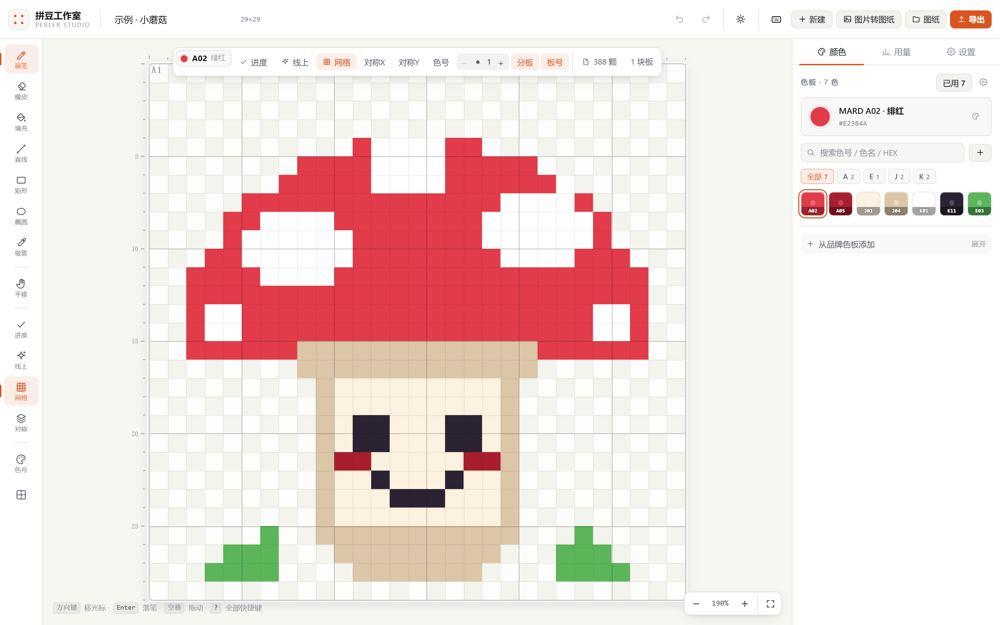

---

## 目录

- [五步上手](#五步上手)
- [功能](#功能)
- [快捷键](#快捷键)
- [本地运行](#本地运行)
- [部署到 GitHub Pages](#部署到-github-pages)
- [技术栈](#技术栈)
- [色号数据来源](#色号数据来源)
- [许可](#许可)

---

## 五步上手

### 1. 建一张画布

点右上角「新建」，填宽 × 高。默认 64 × 64，也可以直接点下面的常见尺寸（16 × 16 迷你、29 × 29 标准方板、58 × 58 大板……）。
关掉「保持正方形」就能做长方形；单边最大 1024 格。

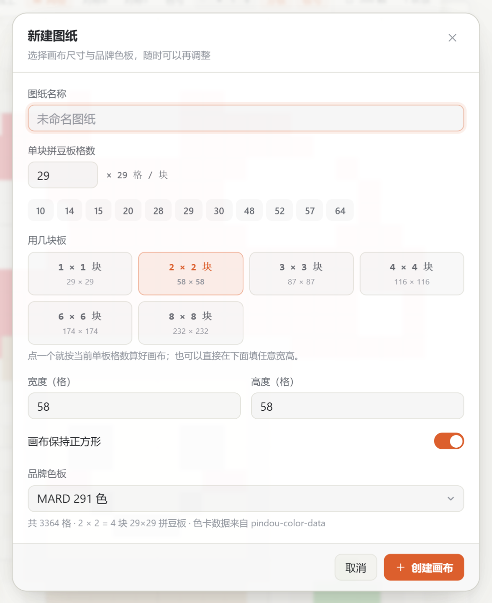

### 2. 选颜色，开始画

右边色板里每个色块上都印着色号，不用点开才知道是哪个色。点一下就选中，然后左键画、右键擦。
网格、坐标标尺、豆孔、分板线都在画布上方的工具条里开关。

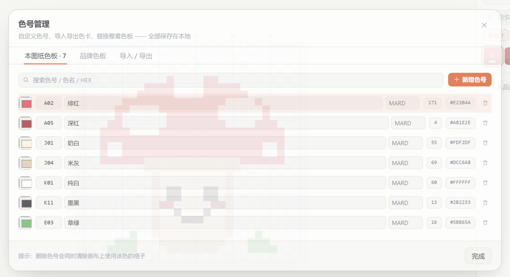

### 3. 或者把一张图片直接变图纸

点「图片转图纸」，把图片拖进去（也可以直接把图片拖到窗口任意位置）。
宽度、抖动、采样方式、亮度 / 对比度 / 饱和度都可以调，右边实时预览。选好色板后点「应用」，整张图就变成可编辑的色块。

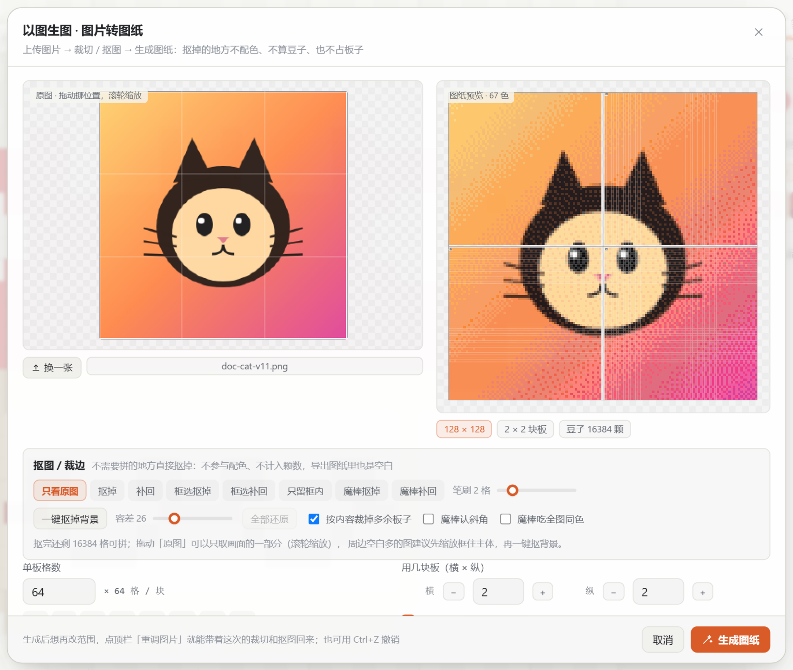

### 4. 勾进度

打开「进度」模式，点已经拼好的豆子就会打勾，没拼的自动变暗，一眼看出拼到哪。
「用量」页同步显示总颗数、已拼、剩余，以及每个色号还差多少颗。

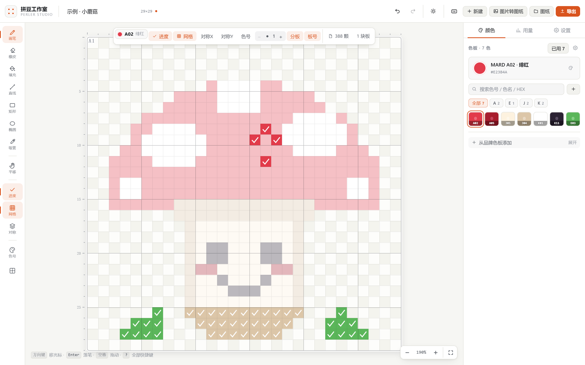

### 5. 导出

导出面板里能实时预览成品：PNG / SVG / PDF / CSV / 工程文件。
PDF 有「整张一页」（看全局）和「一板一页」（按实体板尺寸放大打印）两种排版，带坐标标尺和 50 mm 校准尺。

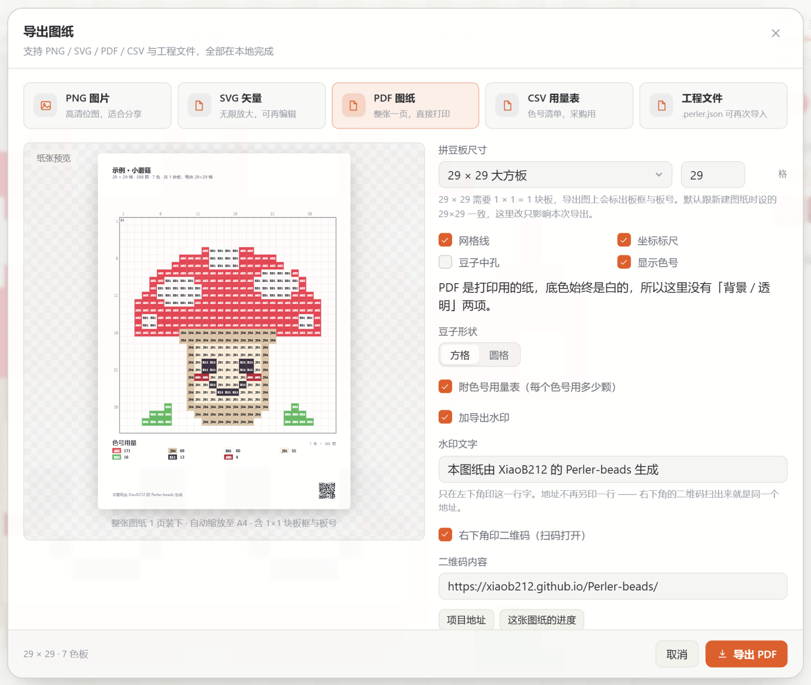

---

## 功能

### 画

- 新建画布：默认 64 × 64，宽高随便填，单边上限 1024 格、总面积上限约 105 万格；可关掉「保持正方形」做长方形
- 单板格数不锁死：内置常见板尺寸（10 / 14 / 15 / 20 / 28 / 29 / 30 / 48 / 52 / 57 / 64）当快捷键，也能填任意数字
- 画笔、橡皮、油漆桶、直线、矩形、椭圆、吸管、平移
- 画笔粗细 1–16，形状可实心或描边
- X / Y 双向对称绘制
- 60 步撤销重做
- 滚轮上下左右平移、`Ctrl+滚轮`以指针为中心缩放、按住空格拖动、按住鼠标中键拖动
- 键盘也能画：方向键移光标、`Enter` 落笔、`Delete` 擦除
- 网格、坐标标尺、豆孔、拼豆板分界线、板号、未拼变暗，全部独立开关
- 画布打开即自动铺满可视区，换尺寸或改窗口大小时重新适配
- 1024 × 1024（百万格）也扛得住：按颜色合批绘制、只画视口内的格子，历史步数按画布面积自动收缩

### 以图生图

- 拖一张图片进窗口即可开始，照片、插画、截图都行
- 手上已有别人的图纸截图也能用：拖进来，自动套成可编辑的色块图纸，之后每格都能改
- 目标宽度可调，高度按比例自动算
- 抖动强度、采样方式（点采样 / 均值）、亮度 / 对比度 / 饱和度、白底透明阈值都可调
- 色差在 **CIEDE2000** 空间里做 k-means 聚类 + Floyd–Steinberg 误差扩散
- 色板可以选「当前图纸色板」，或直接挑 10 套内置品牌色卡里的任意一套
- 不设颜色数量上限，色板里有几色就能用几色

### 色号管理

- 内置 **9 套真实品牌色卡，共 2449 色**：MARD 291、COCO 291、漫漫 278、咪小窝 290、盼盼 289、Artkal 418 / 197 / 221、优肯 174，另有不依赖品牌的基础 32 色
- 色卡数据全部**打包在本地**，运行时零联网
- 色板按色号前缀自动分组（A / B / C…、CT / MA–MM…），可只看某一族
- 每个色块上常显色号，不用点开才知道是什么色
- **色号、色名、HEX、品牌随时都能改**，改完立刻生效——不是导入时定死的
- 自定义增删颜色；删除时自动清理画布上的引用并重映射索引
- **色卡导入 / 导出**：当前色板可导出成 `.palette.json`（含色号、色名、HEX、品牌、单价、库存）或 CSV（可在 Excel 里批量改完再粘回来）
  - 导入认本项目的色卡文件、任意带 HEX 的 JSON 数组、`{A1:"#fff"}` 这种映射写法，以及「色号,色名,HEX」的 CSV / TSV / 直接粘贴
  - 3 位 HEX、带不带 `#`、8 位带透明度、`rgb:[r,g,b]` 数组都能读，重复色自动合并
- **我的色卡**：把调好的一套色板存进浏览器本地，换个图纸一键套用，也能导出成文件备份
- 一键换整套色板，旧色按最近色自动映射到新色板
- 右侧色板底部「从品牌色板添加」：在 9 套官方色卡里按色号或色名搜，点一下加进当前图纸
- 2449 色不会一次铺满页面：先出 96 个，滚到底部按需继续加载

### 用量与成本

- 实时统计总颗数、已拼、剩余、色数
- 按色号明细列出每种颜色需要多少颗、还差多少颗
- **成本估算**：默认单价（元 / 千颗）+ 每个色号单独定价 → 材料费合计、未拼部分花费
- **库存管理**：填每个色号的已有库存 → 自动算出需补货颗数、补货花费，以及库存抵掉的钱
- 分板数量：按单板格数自动算出需要几块板

### 进度

- 进度模式下一键勾选已拼的格子，画布上显示对勾、未拼的自动变暗
- 一键全拼 / 重置进度
- 进度随工程一起保存和导出
- 首次打开的内置示例图纸已经把最下面三行标成「已拼」，打开「进度」就能接着往下勾

### 分板

- 画布上按实体板尺寸画出分界线与板号（A1 / B2 …）
- 设置页底部有板号选择器，每块板显示已拼百分比，点一下聚焦到那块板，再点一次回到全图
- 双击画布上任意一块板也能聚焦
- 键盘 `PageUp` / `PageDown` 上下切板

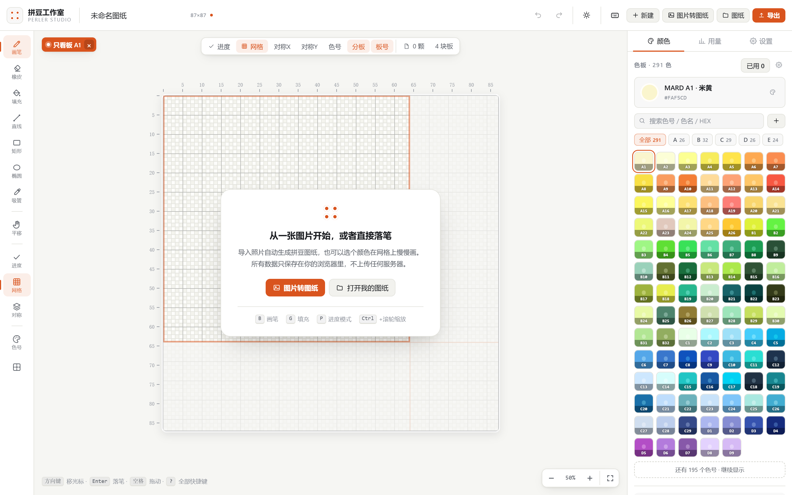

### 导出

| 格式 | 用途 |
| --- | --- |
| PNG | 分享、发群里，可画板框与板号，可选叠印色号 |
| SVG | 矢量图，放大不失真，可进 Illustrator / Figma；打开时自动居中并适配窗口 |
| PDF | 整张图纸缩放进一张 A4 / A3 / Letter，带坐标标尺、5 格加粗线、50 mm 校准尺 |
| CSV | 用量清单（含单价、金额、库存、需补货），可直接进 Excel |
| `.perler.json` | 工程文件，含画布 + 色板 + 进度，可完整恢复 |

导出件默认带：

- **每颗豆子上印色号**（文字带描边，深色豆上反白，不垫色块）
- **色号用量表**：色块 + 色号 + 颗数，一眼看完每种色要多少颗
- **水印**：默认「本图纸由 XiaoB212 的 Perler-beads 生成」+ 项目地址，PDF 里是可点击链接；文案和地址都能改，也能关掉

PDF 有三种排版，都在导出面板里实时预览真实纸张、可翻页：

- **整张一页**：整张图纸等比缩放到一页内，水平垂直都居中，看全局、存档、发人
- **一板一页**：按实体板尺寸切分（预设 10 / 14 / 15 / 20 / 28 / 29 / 30 / 48 / 52 / 57 / 64，也能填任意数字），一块板一页、按真实比例放大，四边带拼装对位标记，打印出来可以直接垫在板子上拼
- **分块**：按每页格数自由切分

大图可以先看「整张一页」确认全局，再切「一板一页」逐块打印。

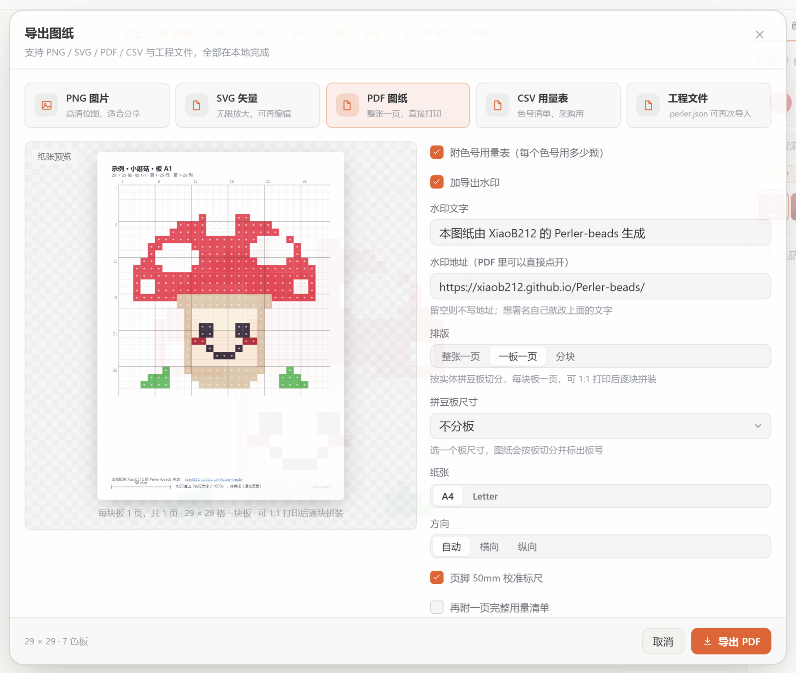

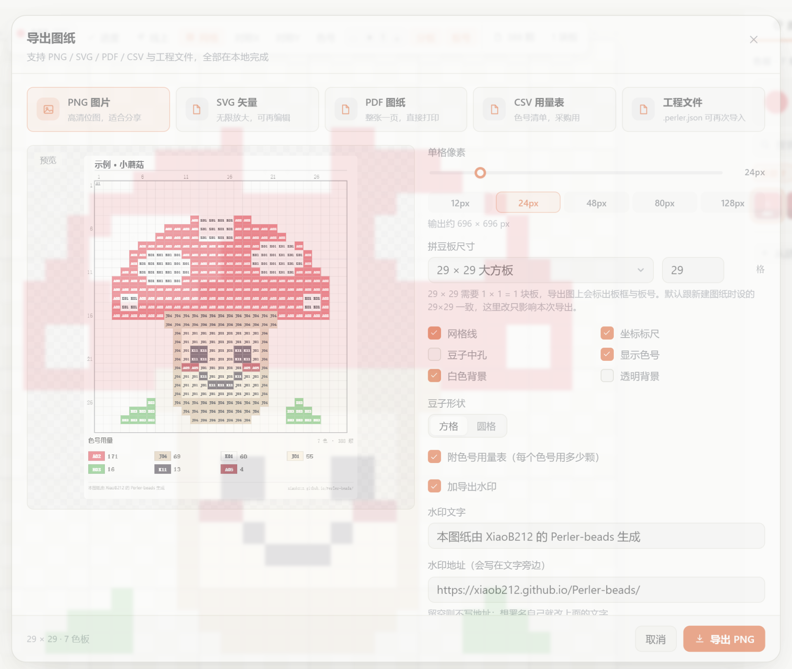

### 本地

- 所有图纸自动存在浏览器 `localStorage`，2.6 秒防抖自动保存，关掉浏览器再打开还在
- 「我的图纸」里可切换、重命名、删除
- 无账号、无后端、无埋点、无网络请求（构建产物完全静态）

### 界面

- **亮色 / 暗色双主题**，也可以跟随系统；切换即时生效并记住选择
- 画布本身也跟着主题走：底板、网格、豆孔、标尺、对勾都有各自的亮暗配色
- 桌面 / 平板 / 手机三端布局，手机上是底部工具条 + 抽屉面板 + 双指缩放
- 右侧面板宽度可以用鼠标拖左边缘调整，双击复位，宽度会被记住

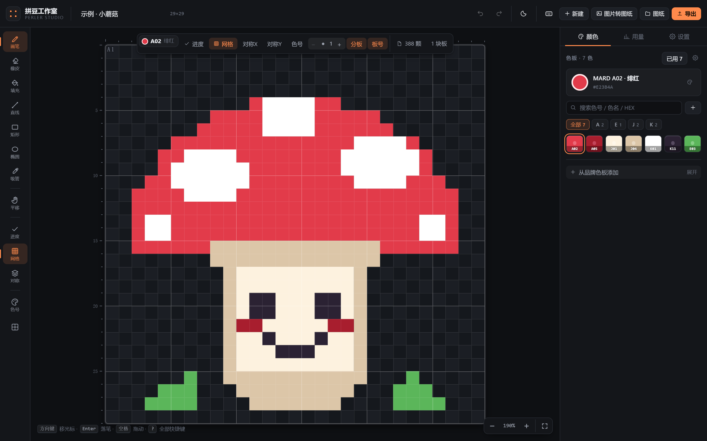

---

## 快捷键

桌面端可以完全不碰鼠标编辑，站内按 `?` 随时叫出这张表，也可以自己改键位（含组合键）。

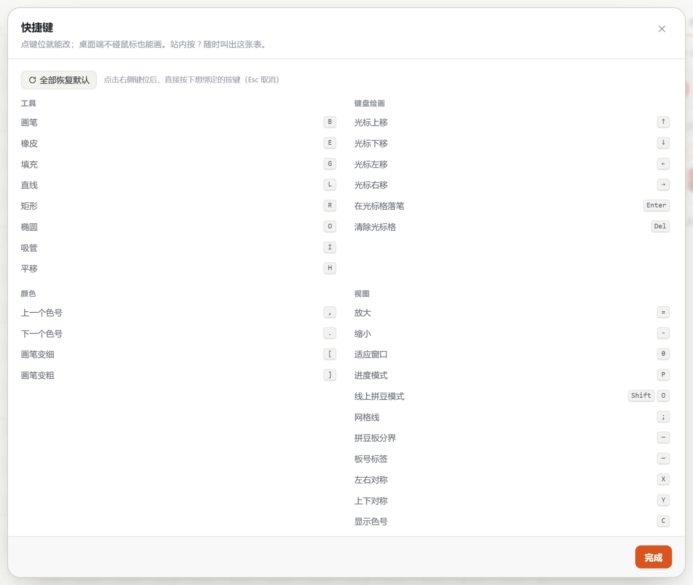

### 工具

| 键 | 作用 |
| --- | --- |
| `B` `E` `G` `L` `R` `O` `I` `H` | 画笔 / 橡皮 / 填充 / 直线 / 矩形 / 椭圆 / 吸管 / 平移 |
| `[` `]` | 画笔变细 / 变粗 |

### 不用鼠标也能画

| 键 | 作用 |
| --- | --- |
| `方向键` | 移动光标（格子） |
| `Shift+方向键` | 一次移动 5 格 |
| `Enter` | 在光标格落笔（进度模式下即勾选已拼） |
| `Delete` / `Backspace` | 清除光标格 |
| `空格+拖动` | 临时平移画布 |

光标移出可视区时画布会自动跟随。

### 颜色

| 键 | 作用 |
| --- | --- |
| `1` – `9` | 直接选中第 1–9 个色号 |
| `,` `.` | 上一个 / 下一个色号 |

### 视图

| 键 | 作用 |
| --- | --- |
| `=` `-` | 放大 / 缩小 |
| `0` | 适应窗口 |
| `Ctrl+滚轮` | 以指针为中心缩放 |
| `P` | 进度模式开关 |
| `;` | 网格开关 |
| `X` `Y` | 左右 / 上下对称开关 |
| `C` | 在豆子上显示色号 |

### 分板

| 键 | 作用 |
| --- | --- |
| `F` | 聚焦光标所在的板 |
| `PageDown` `PageUp` | 下一块 / 上一块板 |

### 文件与编辑

| 键 | 作用 |
| --- | --- |
| `Ctrl+Z` | 撤销 |
| `Ctrl+Shift+Z` / `Ctrl+Y` | 重做 |
| `Ctrl+S` | 保存到本地 |
| `Ctrl+E` | 打开导出 |
| `Ctrl+O` | 图片转图纸 |
| `N` | 新建图纸 |
| `?` | 打开快捷键表 |
| `Esc` | 关闭弹窗 |

在输入框里打字时，以上快捷键不生效。

### 自己改键位

快捷键表里每一行都能重新录制：点一下右侧的键位，按下想用的键或组合键，立刻生效。
冲突会标红提示；随时可以「恢复默认」。

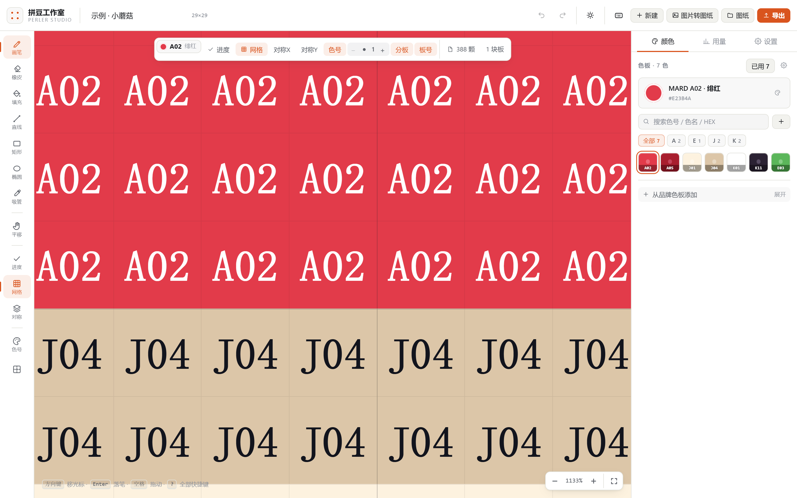

---

## 本地运行

```bash
npm install
npm run dev        # http://127.0.0.1:5173
npm run build      # 产物在 dist/
npm run preview    # 预览构建产物
npm run typecheck  # 只跑类型检查
```

需要 Node 18+。

---

## 部署到 GitHub Pages

仓库已经带了 workflow（`.github/workflows/deploy.yml`），推上去就能用。

1. 在 GitHub 新建一个空仓库（不要勾 README / .gitignore），然后：

   ```bash
   git remote add origin https://github.com/<你的用户名>/<仓库名>.git
   git push -u origin main
   ```

2. 打开仓库 **Settings → Pages**，把 **Source** 设成 **Deploy from a branch**，分支选 `gh-pages`、目录选 `/ (root)`。
   （workflow 第一次跑完后才会出现 `gh-pages` 分支。若想省这一步，也可以在第一次跑 workflow 前先手动建一个空的 `gh-pages` 分支。）

3. 等 Actions 跑完（约 1 分钟），访问 `https://<你的用户名>.github.io/<仓库名>/`。

之后每次 push 到 `main`，workflow 会重新构建并把 `dist/` 推到 `gh-pages` 分支，Pages 自动更新。

`vite.config.ts` 里 `base: './'` 用的是相对路径，放在仓库子路径下也能正常加载。
workflow 会把 `index.html` 复制成 `404.html` 并加上 `.nojekyll`，直接访问深链接也不会 404。

想部署到自己的服务器：把 `dist/` 整个目录丢到任意静态服务器即可。

---

## 技术栈

- React 18 + TypeScript（strict）
- Vite 5，代码分包：jsPDF 单独 chunk，首屏不背 PDF 的体积
- Zustand 做编辑器状态，`Uint16Array` / `Uint8Array` 存像素与进度，60 步快照历史
- 颜色科学：sRGB → CIELAB、CIEDE2000 色差
- 渲染：双 canvas（内容层 + 交互覆盖层），`ResizeObserver` 自适应
- 无 UI 框架，手写 CSS 设计系统，一套语义变量驱动亮 / 暗两套主题

```
src/
  core/        纯逻辑，不依赖 React
    types.ts        数据模型
    palette.ts      色卡入口与别名解析
    palette-data.ts 9 套真实色卡数据（自动生成，勿手改）
    palette-io.ts   色卡文件导入导出与最近色映射
    color.ts        色彩空间与色差
    quantize.ts     图像 → 图纸
    rle.ts          像素压缩
    storage.ts      localStorage 持久化
    export.ts       PNG / SVG / PDF / CSV / 工程文件
    cost.ts         成本与库存
    board.ts        拼豆板尺寸与分板几何
    keymap.ts       可自定义快捷键
    theme.ts        亮暗主题与画布配色
    demo.ts         首次访问的示例图纸
    store.ts        编辑器状态与历史
  components/  画布与各面板
  styles/      设计系统 + 布局 + 画布 + 面板
```

---

## 色号数据来源

色卡数据来自开源项目 **[pindou-color-data](https://github.com/HansBug/pindou-color-data)**（作者 HansBug，MIT 许可，Copyright © 2026 HansBug），覆盖 MARD、COCO、漫漫、咪小窝、盼盼、Artkal、优肯等主流品牌的官方色号与实测 HEX。

- 构建时由 `scripts/gen-palettes.mjs` 拉取并生成为 `src/core/palette-data.ts`，**编译进产物，运行时不发任何网络请求**
- 数据本身不含中文色名，中文色名由脚本按 HSL 色相 + LAB 明度 / 彩度自动生成，仅供辨认，不代表厂商官方命名
- 色卡版权归各厂商所有；本项目对色卡数据的使用遵循上游 MIT 许可，完整声明见 [NOTICE](./NOTICE)
- 若要更新色卡：`node scripts/gen-palettes.mjs`（需要联网，仅开发时用）

---

## 许可

MIT
